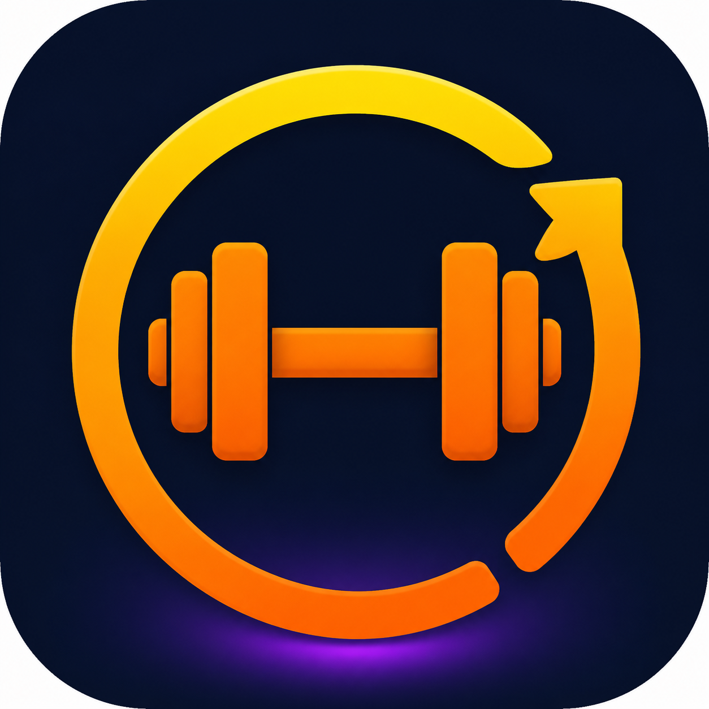

# BetterSet: Gym Workout Tracker

[English](README.md) · [Русский](README.ru.md)

An Android workout log for sets, reps and working weight. Keep your gym history in one place, follow body-weight changes and compare progress photos.

## Download

| Platform | Installation |
|---|---|
| Android | [BetterSet on Google Play](https://play.google.com/store/apps/details?id=com.bettereachset.gymtracker) |

[Website](https://aleksandrkatilov.com/apps/better-each-set/) · [Support](https://aleksandrkatilov.com/apps/better-each-set/support.html) · [Privacy policy](https://aleksandrkatilov.com/apps/better-each-set/privacy.html)

## Features

- Built-in gym programs, including Full Body A/B/C and workouts for individual muscle groups.
- Separate weight and rep counts for each set, kilograms or pounds, and treadmill minutes.
- An active-workout draft so you can leave the screen and continue later.
- Workout history, month and year calendars, training statistics and workout streaks.
- Body-weight history and a chart of your entries.
- Progress photos from the camera or gallery, with two-photo comparison controls.
- Awards for training days, exercises, volume and cardio, plus workout-result cards to share.
- Reminders on selected days and times, English and Russian interfaces, and light, dark or system themes.

## Get started

1. Install BetterSet from Google Play and create your local profile.
2. Choose your weight units and a workout program.
3. Start a workout, enter your sets and finish it to add the results to history.
4. Open the calendar, update your body weight or add progress photos.

**More** contains language, theme, weight units, reminders and data controls. The interface starts in English, and your language selection is saved.

## Data and advertising

Your profile, workout log, body-weight entries and progress photos are stored on your phone. No account is required. Use the app's data controls to save your workout history, and keep the original photos you need before changing devices or uninstalling.

BetterSet includes banner advertising provided by Google Mobile Ads. Advertising uses network services; see the [privacy policy](https://aleksandrkatilov.com/apps/better-each-set/privacy.html) for details.

Reminder delivery depends on Android notification permissions, battery management and device settings. Exact delivery time is not guaranteed. Camera, sound and vibration behavior also depends on your device settings.

## Product descriptions

[English and Russian website descriptions](docs/seo.md).
