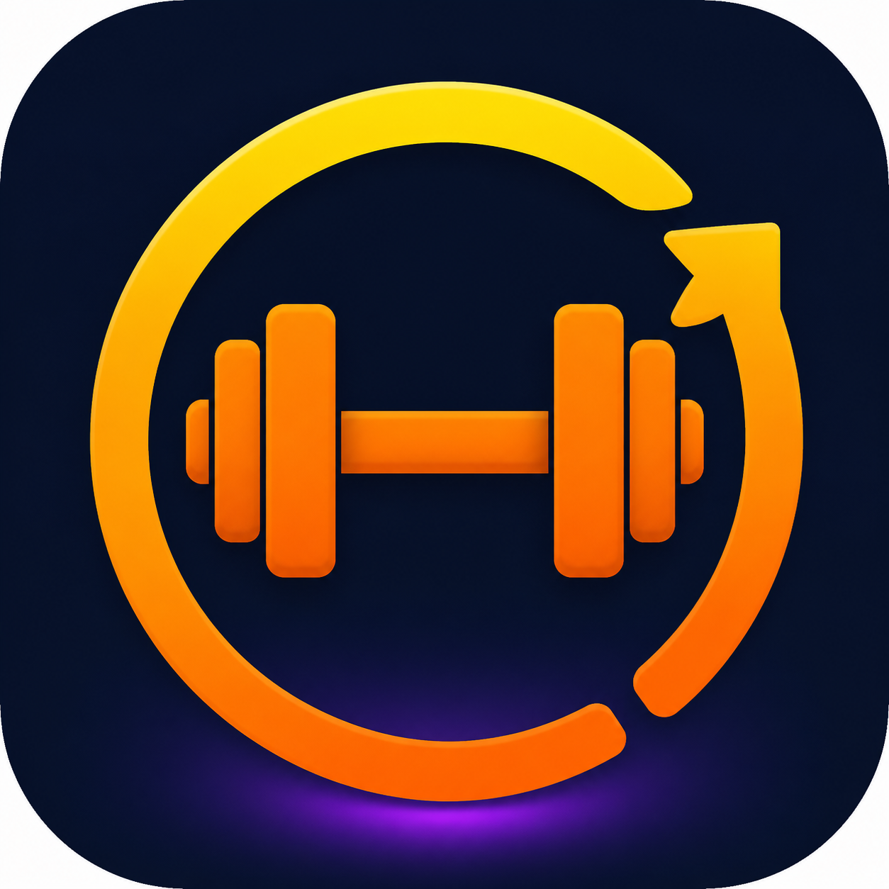

# BetterSet: Gym Workout Tracker

[English](README.md) · [Русский](README.ru.md)

Дневник тренировок для Android: записывайте подходы, повторения и рабочий вес, просматривайте историю занятий, следите за весом тела и сравнивайте фотографии прогресса.

## Скачать

| Платформа | Установка |
|---|---|
| Android | [BetterSet в Google Play](https://play.google.com/store/apps/details?id=com.bettereachset.gymtracker) |

[Сайт](https://aleksandrkatilov.com/apps/better-each-set/) · [Поддержка](https://aleksandrkatilov.com/apps/better-each-set/support.html) · [Политика конфиденциальности](https://aleksandrkatilov.com/apps/better-each-set/privacy.html)

## Возможности

- Готовые программы для зала: Full Body A/B/C и тренировки отдельных групп мышц.
- Вес и повторения отдельно для каждого подхода, килограммы или фунты, минуты на беговой дорожке.
- Черновик активной тренировки: можно уйти с экрана и продолжить позже.
- История, календарь месяца и года, статистика и серии тренировок.
- История веса тела и график изменений.
- Фото с камеры или из галереи и сравнение двух снимков прогресса.
- Награды за тренировочные дни, упражнения, объём и кардио, карточки результатов для отправки друзьям.
- Напоминания в выбранные дни и время, английский и русский интерфейс, светлая, тёмная и системная темы.

## Начало работы

1. Установите BetterSet из Google Play и создайте локальный профиль.
2. Выберите единицы измерения и программу тренировок.
3. Начните занятие, запишите подходы и завершите тренировку, чтобы добавить результаты в историю.
4. Откройте календарь, обновите вес тела или добавьте фото прогресса.

В **More / Ещё** доступны язык, тема, единицы измерения, напоминания и управление данными. По умолчанию интерфейс английский; выбранный язык сохраняется.

## Данные и реклама

Профиль, журнал тренировок, записи веса тела и фото прогресса хранятся на телефоне. Регистрация не нужна. Используйте управление данными для сохранения истории тренировок и сохраняйте нужные оригиналы фотографий перед сменой устройства или удалением приложения.

В BetterSet есть баннерная реклама Google Mobile Ads. Реклама использует сетевые сервисы; подробности — в [политике конфиденциальности](https://aleksandrkatilov.com/apps/better-each-set/privacy.html).

Доставка напоминаний зависит от разрешений Android, энергосбережения и настроек уведомлений. Точное время не гарантируется. Камера, звук и вибрация также зависят от настроек устройства.

## Описания продукта

[Тексты для сайта на английском и русском](docs/seo.md).
